<div align="center">


# CleanReport

**Aplikasi mobile untuk melaporkan pembuangan sampah sembarangan dengan foto dan lokasi GPS, lalu memantau tindak lanjutnya.**


-FFCA28?logo=firebase&logoColor=black)


*Proyek Project-Based Learning · Mata Kuliah Pemrograman Perangkat Bergerak*

</div>

---

## Daftar Isi

1. [Identitas Proyek](#1-identitas-proyek)
2. [Latar Belakang dan Tujuan](#2-latar-belakang-dan-tujuan)
3. [Fitur](#3-fitur)
4. [Desain Antarmuka](#4-desain-antarmuka)
5. [Alur dan Arsitektur Sistem](#5-alur-dan-arsitektur-sistem)
6. [Teknologi yang Digunakan](#6-teknologi-yang-digunakan)
7. [Struktur Proyek](#7-struktur-proyek)
8. [Model Data (Firestore)](#8-model-data-firestore)
9. [Keamanan dan Privasi](#9-keamanan-dan-privasi)
10. [Memulai (Instalasi dan Menjalankan)](#10-memulai-instalasi-dan-menjalankan)
11. [Menyambungkan Firebase (Gratis)](#11-menyambungkan-firebase-gratis)
12. [Panel Admin Web](#12-panel-admin-web)
13. [Build dan Distribusi](#13-build-dan-distribusi)
14. [Cara Memperbarui yang Sudah Dipublikasikan](#14-cara-memperbarui-yang-sudah-dipublikasikan)
15. [Kesesuaian dengan Proposal](#15-kesesuaian-dengan-proposal)
16. [Pengujian](#16-pengujian)
17. [Batasan dan Rencana Pengembangan](#17-batasan-dan-rencana-pengembangan)
18. [Pemecahan Masalah](#18-pemecahan-masalah)
19. [Studi Pembanding, Referensi, dan Lisensi](#19-studi-pembanding-referensi-dan-lisensi)

---

## 1. Identitas Proyek

| | |
|---|---|
| **Nama aplikasi** | CleanReport (Aplikasi Lapor Sampah) |
| **Judul proyek** | Pengembangan Aplikasi Mobile untuk Pelaporan Pembuangan Sampah Sembarangan |
| **Mata kuliah** | Pemrograman Perangkat Bergerak (Project-Based Learning) |
| **Dosen pengampu** | Marisha Pertiwi, S.Tr.Kom., M.Kom |
| **Kelompok** | 7 |
| **Program studi** | Teknik Informatika, Jurusan Teknik Informatika dan Elektro |
| **Fakultas / Universitas** | Fakultas Teknik dan Teknologi Kemaritiman, Universitas Maritim Raja Ali Haji (2026) |
| **Repositori** | https://github.com/Raihan2407/CleanReport-V2.git |
| **Desain Figma** | https://www.figma.com/design/wUShKqpBL5RW2qcGGKlrod/PPB |

### Tim

| Peran | Nama | NIM |
|---|---|---|
| Ketua | Muhammad Dimaz Albintani | 2401020159 |
| Anggota | Siti Muharramah | 2401020116 |
| Anggota | Raihan Darma Putra | 2401020138 |
| Anggota | M. Bagas Risllah | 2401020146 |
| Anggota | Bunga Salsabila | 2401020150 |
| Anggota | Kristian Nugroho Keliat | 2401020152 |

---

## 2. Latar Belakang dan Tujuan

Pembuangan sampah sembarangan adalah persoalan lingkungan yang berkaitan langsung dengan perilaku masyarakat. Pasal 29 ayat (1) huruf e UU No. 18 Tahun 2008 tentang Pengelolaan Sampah melarang setiap orang membuang sampah tidak pada tempat yang ditentukan, dengan pengaturan lebih lanjut melalui peraturan daerah. Upaya mengurangi masalah ini membutuhkan peran serta masyarakat, salah satunya lewat pelaporan temuan sampah kepada pihak yang berwenang.

Kendala yang umum dialami pelapor adalah menyampaikan bukti kejadian, menjelaskan lokasi dengan tepat, mencatat laporan, dan memantau tindak lanjutnya. Ponsel pintar menyediakan kamera dan sensor lokasi pada satu perangkat, sehingga foto dan koordinat dapat dilampirkan saat sampah ditemukan. CleanReport memanfaatkan hal itu dalam satu aplikasi lintas platform yang berfokus pada **sisi pelapor**, dilengkapi panel admin sederhana untuk menindaklanjuti laporan.

**Rumusan masalah**

1. Bagaimana merancang dan mengembangkan aplikasi mobile CleanReport untuk memfasilitasi pelaporan pembuangan sampah sembarangan yang dilengkapi foto, lokasi, riwayat, dan status laporan?
2. Bagaimana penerapan dan integrasi Flutter, Firebase, peta, serta GPS/Location Service dalam mendukung fungsi pelaporan dan pemantauan laporan?

**Tujuan**

1. Merancang dan mengembangkan aplikasi yang menyediakan pembuatan laporan beserta foto dan lokasi, serta penelusuran riwayat dan status laporan.
2. Menentukan, menerapkan, dan mengintegrasikan teknologi yang sesuai untuk fungsi pelaporan dan pemantauan.

**Manfaat**

- **Masyarakat:** cara melapor yang terstruktur dengan lampiran foto dan lokasi, serta riwayat dan status yang dapat diperiksa.
- **Petugas / pihak yang menindaklanjuti:** laporan berisi foto, titik lokasi, dan jenis sampah yang membantu memahami kondisi lapangan. Manfaat ini bergantung pada adanya pihak yang mengelola laporan; belum ada kerja sama resmi dengan instansi mana pun.
- **Mahasiswa pengembang:** sarana menerapkan pemrograman perangkat bergerak, rekayasa perangkat lunak, pengolahan data, serta integrasi backend, kamera, dan lokasi.

---

## 3. Fitur

### Aplikasi warga (Android)

| Fitur | Keterangan |
|---|---|
| **Animasi pembuka** | Riak air, lencana logo, cincin, daun, dan centang tergambar, lalu nama aplikasi muncul per huruf. Ketuk untuk melewati. Menghormati pengaturan "kurangi animasi" sistem. |
| **Foto bukti** | Ambil dengan kamera atau pilih dari galeri; foto dikecilkan otomatis dan bisa diganti. |
| **GPS realtime** | Titik biru bergerak, lingkaran akurasi (±meter), tombol "ikuti saya", dan alamat otomatis dari koordinat. Pelacakan berhenti saat aplikasi di latar belakang atau tab lain untuk menghemat baterai. |
| **Peta OpenStreetMap** | Pratinjau di halaman Lapor; ketuk untuk membuka peta penuh yang dapat digeser dan di-zoom dengan pin di tengah ("Ubah Titik"). |
| **Penanganan izin** | Pesan jelas dan tombol aksi saat GPS mati atau izin ditolak; titik tetap bisa dipilih manual di peta. |
| **Peringatan laporan ganda** | Menampilkan laporan lain yang masih terbuka dalam radius 150 m beserta penandanya di peta (tanpa foto dan nama). |
| **Formulir** | Empat jenis sampah (pilih satu), patokan lokasi opsional, mode anonim atau nama pelapor, validasi, dan batas 10 laporan per 24 jam per perangkat. |
| **Kirim offline** | Bila internet putus, laporan tersimpan di HP dan terkirim otomatis saat tersambung (penanda "Menunggu internet"). |
| **Riwayat** | Daftar laporan milik sendiri, filter status dengan jumlah, tarik untuk memuat ulang, tampilan kosong dan gagal muat. |
| **Detail laporan** | Foto bukti, pembanding **sebelum/sesudah**, linimasa status dengan **catatan petugas**, rincian, peta, buka di Google Maps, bagikan ke WhatsApp, dan telepon petugas. |
| **Status realtime** | Perubahan dari admin langsung tampil; titik merah di tab Riwayat, penanda "Pembaruan baru", dan notifikasi HP. |
| **Hapus laporan** | Pelapor dapat menghapus laporannya sendiri selama status "Laporan Diterima" atau "Ditolak". |
| **Bantuan** | Lembar cara melapor dan tombol telepon dari header. |
| **Mode lokal** | Bila Firebase belum dikonfigurasi, aplikasi tetap berjalan dengan data tersimpan di HP (cocok untuk demo). |

### Panel admin (web, satu berkas)

| Fitur | Keterangan |
|---|---|
| Login admin | Email dan kata sandi (Firebase Authentication); hanya akun yang terdaftar di koleksi `admins` yang boleh masuk. |
| Daftar realtime | Laporan baru muncul otomatis dengan bunyi bip dan pemberitahuan; filter status, pencarian, dan hitungan baru/diproses/selesai/ditolak. |
| Detail dan peta | Foto laporan, foto sesudah, koordinat, tautan Google Maps, dan peta Leaflet/OpenStreetMap. |
| Tindak lanjut | Ubah status, tulis catatan untuk pelapor, unggah foto sesudah (dikecilkan otomatis). |
| **Tolak** | Status "Ditolak" dengan alasan wajib; bersifat **dapat dibatalkan** (ubah status kembali untuk memulihkan). |
| **Hapus permanen** | Pilihan terakhir dengan konfirmasi dan alasan wajib. |
| **Log penghapusan** | Mencatat siapa menghapus apa dan kapan (id, kode, status, waktu; **tanpa isi laporan**). |
| Ekspor | Unduh daftar laporan dalam format CSV. |

### Status laporan

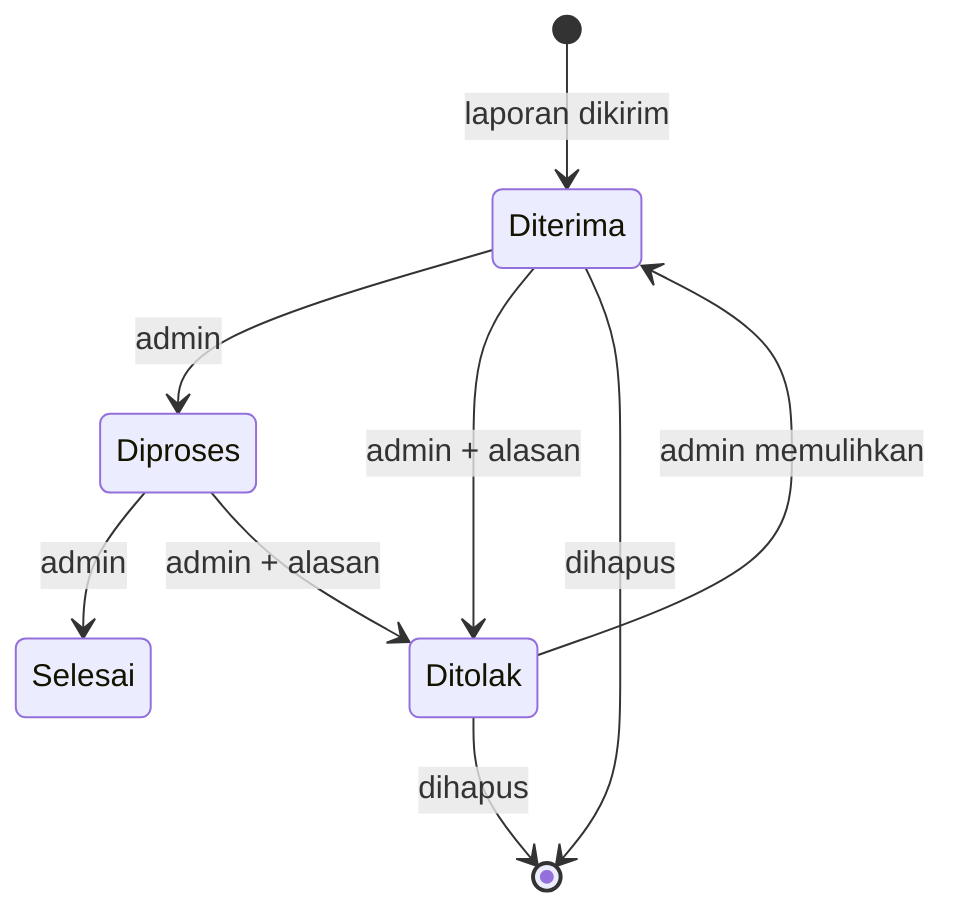

> Status awal "Laporan Diterima" diberikan sistem saat laporan tersimpan. Status lain diubah oleh admin lewat panel.

---

## 4. Desain Antarmuka

Antarmuka dirancang di Figma dan diimplementasikan dengan warna, tipografi (Atkinson Hyperlegible Next), dan komponen yang sama: kartu putih berbayang, pil status, dan navigasi bawah dua tab.

<table>
  <tr>
    <th align="center">Lapor</th>
    <th align="center">Formulir</th>
    <th align="center">Riwayat</th>
    <th align="center">Detail</th>
  </tr>
  <tr>
    <td>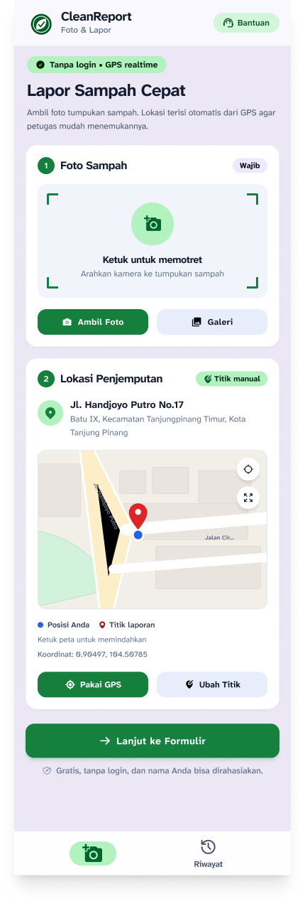</td>
    <td>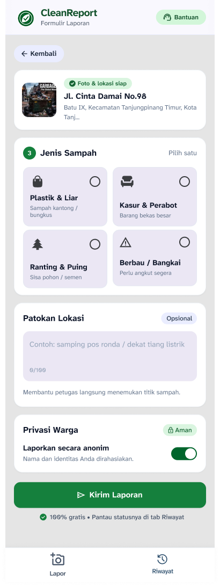</td>
    <td>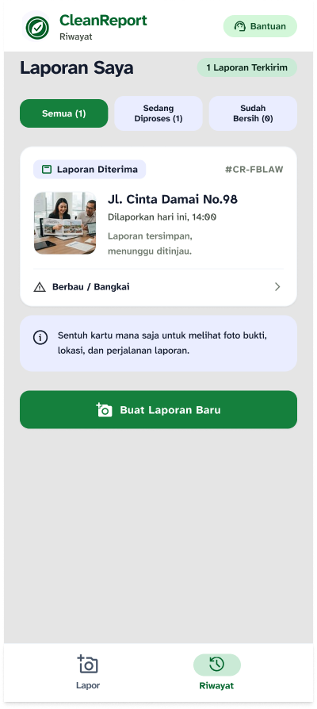</td>
    <td>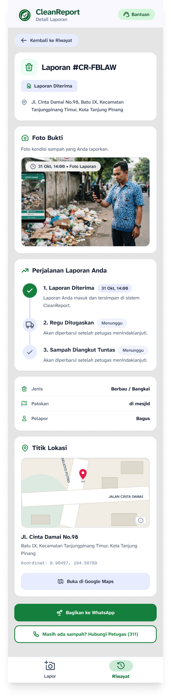</td>
  </tr>
</table>

*Gambar di atas adalah rancangan Figma. Implementasi mengikuti rancangan tersebut dengan beberapa penyesuaian fungsional (lihat [bagian 15](#15-kesesuaian-dengan-proposal)).*

## Tangkapan Layar Aplikasi

<table>
  <tr>
    <td align="center">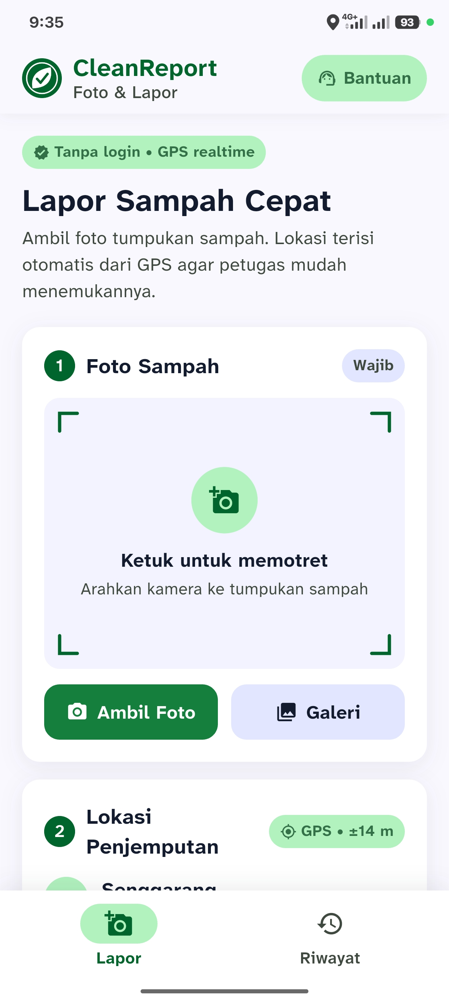</td>
    <td align="center">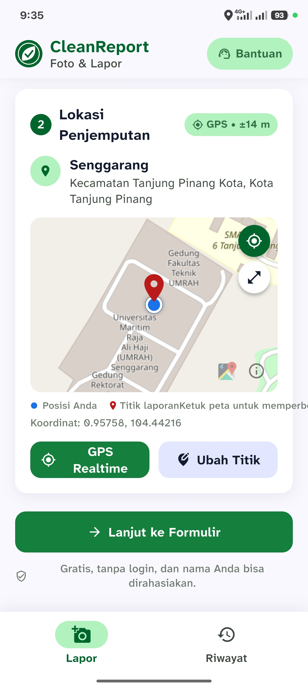</td>
    <td align="center">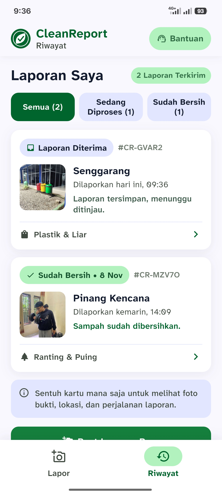</td>
    <td align="center">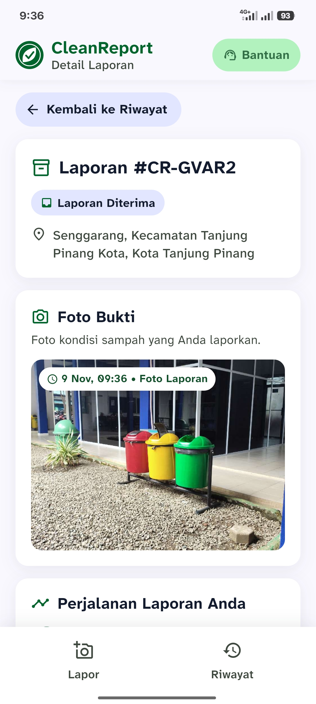</td>
  </tr>
</table>
---

## 5. Alur dan Arsitektur Sistem

### Alur pelapor

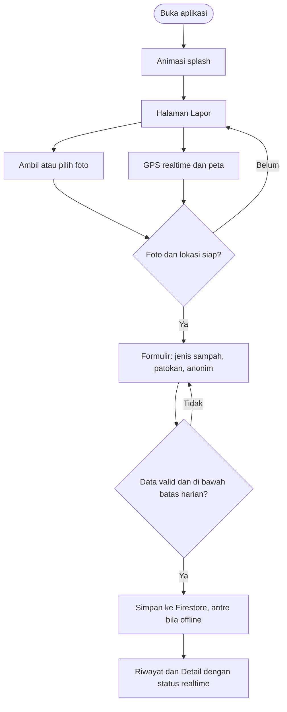

### Arsitektur

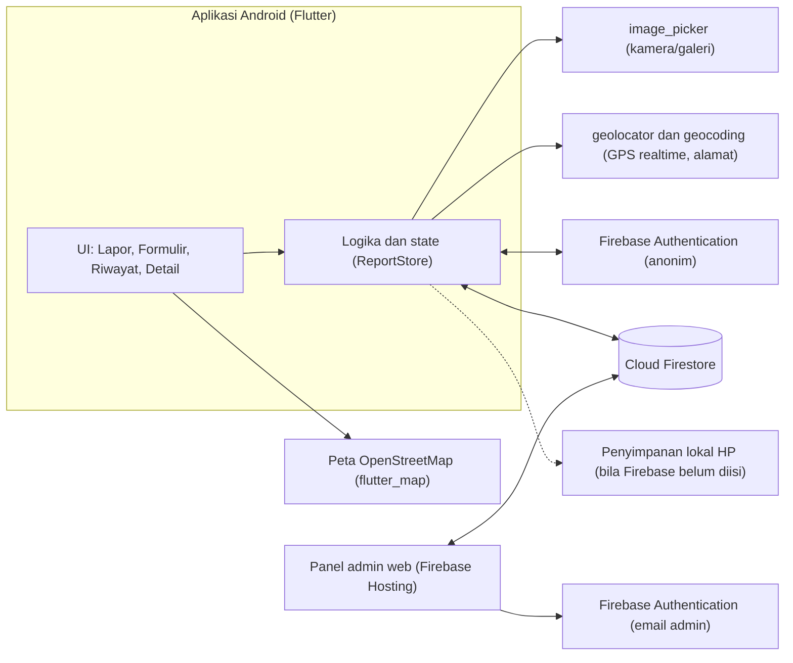

**Prinsip rancangan**

- **Satu sumber data, dua implementasi.** `ReportRepository` memiliki implementasi `CloudReportRepository` (Firebase) dan `LocalReportRepository` (HP). Aplikasi memilih secara otomatis berdasarkan isi `firebase_options.dart`.
- **Realtime.** Riwayat dan Detail berlangganan aliran data Firestore sehingga perubahan dari admin langsung muncul.
- **Offline-first untuk penulisan.** Firestore menyimpan penulisan di HP dan mengirimnya saat internet kembali.
- **Tanpa server sendiri.** Seluruh logika backend memakai layanan Firebase paket gratis dan aturan keamanan.

---

## 6. Teknologi yang Digunakan

| Teknologi | Fungsi | Catatan |
|---|---|---|
| **Flutter dan Dart** | Antarmuka dan logika aplikasi | Satu basis kode |
| **Firebase Authentication** | Identitas pengguna anonim (warga) dan email (admin) | Paket Spark, gratis |
| **Cloud Firestore** | Data laporan, riwayat status, titik publik, log | Paket Spark, gratis, dengan kuota harian |
| **Firebase Hosting** | Menayangkan panel admin | Paket Spark, gratis |
| **flutter_map + OpenStreetMap** | Peta | Tanpa kunci API dan tanpa kartu pembayaran |
| **geolocator** | Posisi GPS realtime dan izin lokasi | |
| **geocoding** | Koordinat menjadi alamat | |
| **image_picker** | Kamera dan galeri | |
| **flutter_local_notifications** | Notifikasi saat status berubah | Notifikasi lokal, tanpa server |
| **shared_preferences, path_provider** | Penyimpanan lokal, pembatas harian, status terakhir | |
| **url_launcher** | Telepon, WhatsApp, Google Maps | |
| **Leaflet** | Peta pada panel admin | |
| **Figma** | Rancangan antarmuka | |
| **GitHub** | Repositori dan rilis APK | |

---

## 7. Struktur Proyek

```text
.
├── lib/
│   ├── main.dart                     # titik masuk, inisialisasi store
│   ├── config.dart                   # nomor bantuan, radius, batas harian, batas foto, URL peta
│   ├── theme.dart                    # warna, tipografi, bayangan (mengikuti Figma)
│   ├── models.dart                   # Report, ReportStatus, StatusEntry, NearbyPoint, kategori
│   ├── format.dart  geo.dart         # format tanggal, jarak (haversine)
│   ├── firebase_options.dart         # konfigurasi Firebase (nilai contoh sampai diisi)
│   ├── screens/
│   │   ├── splash_screen.dart        # animasi pembuka
│   │   ├── home_shell.dart           # 2 tab + navigasi bawah
│   │   ├── lapor_screen.dart         # foto, GPS realtime, peta, laporan di sekitar
│   │   ├── pick_location_screen.dart # peta penuh pemilih titik
│   │   ├── form_screen.dart          # formulir + layar sukses
│   │   ├── riwayat_screen.dart       # daftar dan filter
│   │   └── detail_screen.dart        # detail, linimasa, sebelum/sesudah, hapus
│   ├── services/
│   │   ├── app_state.dart            # ReportStore: data, tab, notifikasi, pembaruan
│   │   ├── report_repository.dart    # antarmuka + penyimpanan lokal
│   │   ├── cloud_report_repository.dart  # Firebase Auth + Firestore
│   │   ├── location_service.dart     # izin, GPS sekali, GPS realtime, alamat
│   │   ├── notify_service.dart       # notifikasi lokal
│   │   └── rate_limiter.dart         # batas laporan per 24 jam
│   └── widgets/                      # komponen bersama (tombol, kartu, peta, header, nav)
├── admin/
│   └── index.html                    # panel admin (Firebase JS SDK + Leaflet)
├── firestore.rules                   # aturan keamanan Firestore
├── android/                          # konfigurasi Android (izin, applicationId, ikon, penandatanganan)
├── assets/                           # logo, ikon Play Store, font
├── docs/design/                      # gambar rancangan Figma
├── test/widget_test.dart             # uji widget dasar
└── pubspec.yaml
```

---

## 8. Model Data (Firestore)

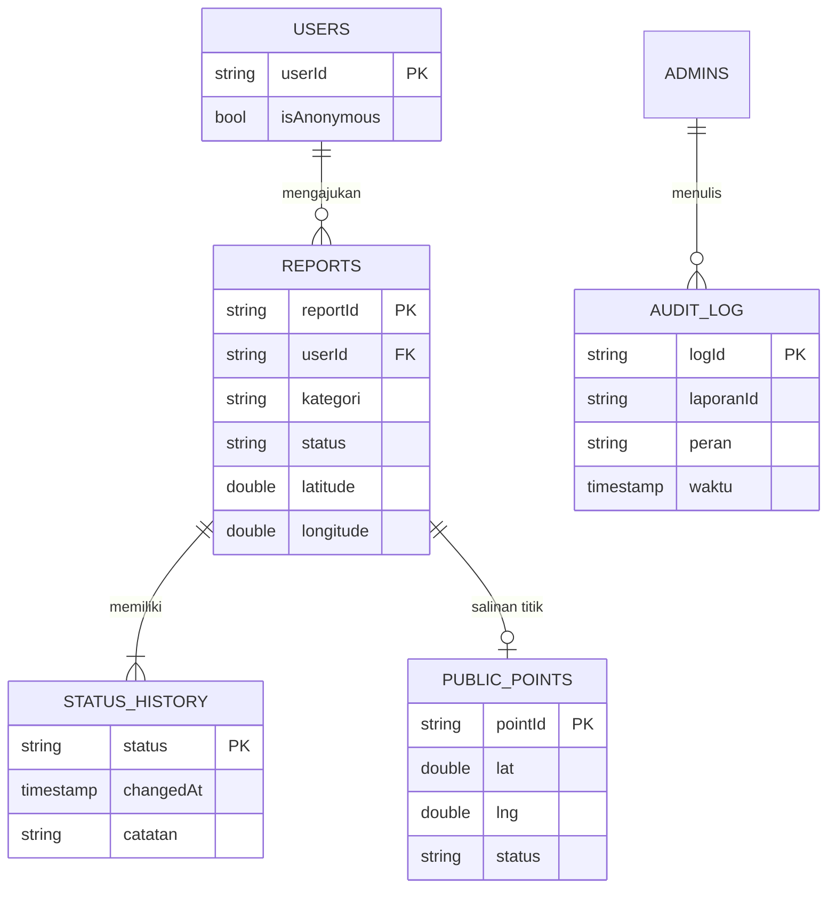

| Koleksi | Isi |
|---|---|
| `reports/{id}` | `userId`, `kategori`, `patokanLokasi`, `namaPelapor`, `anonim`, `latitude`, `longitude`, `alamatTeks`, `alamatDetail`, `fotoSebelumB64`, `fotoSesudahB64` (diisi admin), `status` (`received`, `inProgress`, `done`, `rejected`), `createdAt`, `updatedAt` |
| `reports/{id}/statusHistory/{status}` | `status`, `changedAt`, `catatan` (alasan atau catatan petugas) |
| `public_points/{id}` | `userId`, `lat`, `lng`, `kategori`, `status`, `createdAt` (tanpa foto dan nama; untuk peringatan laporan ganda) |
| `audit_log/{auto}` | `laporanId`, `kode`, `aksi`, `peran` (`admin`/`pelapor`), `uid`, `email`, `status`, `waktu`, `alasan` (tanpa isi laporan) |
| `admins/{uid}` | `name` (dibuat manual dari konsol Firebase) |

> **Foto** disimpan sebagai teks base64 di dokumen laporan (tanpa Cloud Storage agar tetap gratis). Satu dokumen Firestore maksimal 1 MiB dan memuat foto warga serta foto sesudah, sehingga **tiap foto dibatasi 350 KB**; aplikasi dan panel mengecilkannya otomatis.

---

## 9. Keamanan dan Privasi

| Aspek | Penerapan |
|---|---|
| **Identitas** | Warga memakai login anonim Firebase, tanpa daftar. Nama bersifat opsional dan hanya disimpan bila pelapor mematikan mode anonim. **Nomor kontak tidak disimpan.** |
| **Hak akses** | Aturan Firestore: warga hanya membaca laporannya sendiri; admin (akun terdaftar di `admins`) membaca dan mengubah semua. |
| **Validasi di server** | Aturan menolak field tak dikenal, tipe salah, teks terlalu panjang, koordinat di luar rentang, jenis sampah di luar empat kategori, dan status awal selain `received`. |
| **Hapus** | Warga hanya dapat menghapus saat status `received` atau `rejected`. Setiap penghapusan tercatat di `audit_log`. |
| **Laporan ganda** | Hanya titik, jenis, dan status yang dibagikan ke pengguna lain, tanpa foto dan nama. |
| **Anti-spam** | Batas 10 laporan per 24 jam (di sisi aplikasi). |
| **Panel admin** | Semua teks dari warga disaring sebelum ditampilkan (mencegah XSS); akses admin dicek lewat dokumen `admins/{uid}`. |
| **Pelindungan data pribadi** | Data diminimalkan sejalan dengan prinsip UU No. 27 Tahun 2022 tentang Pelindungan Data Pribadi. Lokasi dan foto dapat memuat informasi terkait individu sehingga akses dibatasi pada pemilik laporan dan admin. |

> Dokumen ini tidak menyatakan sistem telah memenuhi standar keamanan tertentu. Batasan yang diketahui dicantumkan di [bagian 17](#17-batasan-dan-rencana-pengembangan).

---

## 10. Memulai (Instalasi dan Menjalankan)

### Prasyarat

- **Flutter SDK** (kanal stable; proyek memerlukan Dart 3.5 atau lebih baru) dan **Git**
- **Android SDK** (pasang lewat Android Studio, termasuk *Command-line Tools* lalu `flutter doctor --android-licenses`)
- **HP Android** dengan *Opsi Pengembang → Debugging USB* aktif (atau emulator)
- **Windows:** aktifkan *Developer Mode* (`start ms-settings:developers`) agar plugin dapat dipasang

```bash
flutter doctor        # semua bagian Android toolchain harus bercentang
```

### Menjalankan

```bash
git clone https://github.com/Kristian1405/Project-PPB.git
cd Project-PPB
flutter pub get
flutter run           # HP tersambung USB, atau pilih perangkat dengan -d
```

Tanpa konfigurasi Firebase, aplikasi berjalan dalam **mode lokal**: data tersimpan di HP, peta dan GPS tetap berfungsi, tetapi tidak ada sinkron dan panel admin. Teks "Mode lokal" tampil di bawah halaman Riwayat. Untuk menyalakan Firebase, ikuti bagian berikut.

### Pemeriksaan kode

```bash
flutter analyze       # seharusnya tanpa error
flutter test          # uji widget dasar
```

---

## 11. Menyambungkan Firebase (Gratis)

Semua langkah memakai paket **Spark** (tanpa kartu pembayaran). **Jangan** mengaktifkan Cloud Storage.

1. Buka <https://console.firebase.google.com> → **Add project**.
2. **Authentication → Sign-in method:** aktifkan **Anonymous** dan **Email/Password**.
3. **Firestore Database → Create database** (production mode, lokasi `asia-southeast2` atau `asia-southeast1`).
4. Tab **Rules:** hapus isi lama, tempel seluruh isi [`firestore.rules`](firestore.rules), lalu **Publish**.
5. **Akun admin:** Authentication → Users → **Add user** (email dan sandi), salin **User UID**. Di Firestore buat koleksi **`admins`**, *Document ID* = UID tadi, dengan satu field `name` (string).
6. **Hubungkan aplikasi Android** (sekali saja):
   ```bash
   dart pub global activate flutterfire_cli
   flutterfire configure --platforms=android --android-package-name=id.ac.umrah.cleanreport.v2
   ```
   Perintah ini menimpa `lib/firebase_options.dart` dengan nilai proyek Anda. Setelah itu aplikasi otomatis memakai Firebase.
7. **Hubungkan panel admin:** Project settings → *Your apps* → tambah **Web app** → salin konfigurasinya ke bagian `firebaseConfig` di `admin/index.html`.

> `firebase_options.dart` dan `firebaseConfig` berisi pengenal proyek yang memang bersifat publik; keamanan data dijaga oleh aturan Firestore, bukan oleh kerahasiaan nilai tersebut.

---

## 12. Panel Admin Web

**Menjalankan lokal** (di folder `admin`):

```powershell
py -m http.server 8080        # atau: python -m http.server 8080
```

Buka <http://localhost:8080>. Jangan membuka berkas langsung dengan klik ganda karena login Firebase memerlukan alamat `localhost` atau domain yang diizinkan.

**Menayangkan gratis dengan Firebase Hosting:**

```bash
npm install -g firebase-tools
firebase login
firebase init hosting         # public directory: admin | single-page app: No
firebase deploy --only hosting
```

Setelah ditayangkan, tambahkan domain hosting di *Authentication → Settings → Authorized domains* bila belum otomatis.

**Memakai panel**

1. Masuk dengan akun admin.
2. Pilih laporan di daftar kiri; detail dan peta tampil di kanan.
3. Ubah status, tulis catatan atau alasan, unggah foto sesudah, lalu **Simpan perubahan**.
4. Untuk spam atau laporan tidak valid, pilih status **Ditolak** dan tulis alasan (dapat dibatalkan). **Hapus laporan** hanya sebagai pilihan terakhir.
5. **Log penghapusan** menampilkan 50 penghapusan terakhir.

---

## 13. Build dan Distribusi

### APK

```bash
flutter build apk --release
# hasil: build/app/outputs/flutter-apk/app-release.apk
```

### Pilihan distribusi gratis

| Cara | Keterangan |
|---|---|
| **GitHub Releases** | Unggah APK pada rilis; pengguna mengunduh dan mengizinkan "install dari sumber tidak dikenal". |
| **Firebase App Distribution** | Console → *Release & Monitor → App Distribution* → seret APK → tambah penguji (email atau tautan undangan) → Distribute. Penguji memasang lewat aplikasi *Firebase App Tester* dan mendapat kabar tiap ada versi baru. |
| **Google Play Store** | Berbayar (biaya pendaftaran satu kali) dan akun pribadi baru memerlukan tahap uji tertutup; periksa persyaratan terbaru di Play Console. Memerlukan keystore, `.aab`, kebijakan privasi, dan formulir *Data safety*. |

### Penandatanganan rilis

Tanpa `android/key.properties`, build rilis memakai kunci debug (cukup untuk pengujian). Untuk Play Store, buat keystore sendiri:

```bash
keytool -genkey -v -keystore ~/cleanreport-upload.jks -keyalg RSA -keysize 2048 -validity 10000 -alias upload
```

Buat `android/key.properties` (sudah masuk `.gitignore`):

```properties
storePassword=PASSWORD_ANDA
keyPassword=PASSWORD_ANDA
keyAlias=upload
storeFile=/lokasi/lengkap/cleanreport-upload.jks
```

Lalu `flutter build appbundle --release`. **Simpan keystore dengan aman dan jangan commit ke Git.**

> Setiap rilis baru: naikkan `version:` di `pubspec.yaml` (mis. `2.2.1+4`). Angka setelah `+` harus selalu lebih besar. Bangun APK dari komputer dan kunci yang sama agar pembaruan dapat dipasang di atas versi lama.

---

## 14. Cara Memperbarui yang Sudah Dipublikasikan

Urutan ini penting karena aplikasi dan panel bergantung pada aturan Firestore.

1. **Aturan Firestore (paling dulu).** Console → Firestore → Rules → tempel isi `firestore.rules` terbaru → **Publish**.
2. **Panel admin.**
   ```bash
   firebase deploy --only hosting
   ```
   Lalu muat ulang panel dengan **Ctrl + F5**.
3. **Aplikasi.**
   ```bash
   flutter build apk --release
   git add .
   git commit -m "vX.Y.Z: deskripsi perubahan"
   git push
   ```
   Lalu buat rilis baru di GitHub (*Releases → Draft a new release*), beri tag `vX.Y.Z`, dan unggah APK.
4. **Pengguna** memasang APK baru di atas yang lama; data tetap ada karena tersimpan di Firebase.

> **Kompatibilitas:** aplikasi versi lama tidak mengenal status baru (misalnya "Ditolak") dan menampilkannya sebagai "Laporan Diterima". Minta pengguna memperbarui aplikasi sebelum fitur baru dipakai.

---

## 15. Kesesuaian dengan Proposal

### Kebutuhan fungsional

| ID | Kebutuhan | Implementasi |
|---|---|---|
| KF01 | Halaman Lapor sebagai halaman awal dengan navigasi Lapor dan Riwayat | `home_shell.dart`, `bottom_nav.dart` |
| KF02 | Foto lewat kamera atau galeri | `lapor_screen.dart` (`image_picker`) |
| KF03 | Koordinat perangkat setelah izin lokasi | `location_service.dart` (`LiveLocation`) |
| KF04 | Titik pada peta dan penyesuaian titik | `app_map.dart`, `pick_location_screen.dart` |
| KF05 | Formulir empat jenis sampah dan patokan opsional | `form_screen.dart`, `models.dart` |
| KF06 | Validasi foto, lokasi, dan jenis sampah | `lapor_screen.dart`, `form_screen.dart` |
| KF07 | Simpan laporan dan foto, status awal "Laporan Diterima" | `cloud_report_repository.dart`, `report_repository.dart` |
| KF08 | Riwayat laporan milik pengguna | `riwayat_screen.dart` |
| KF09 | Filter riwayat berdasarkan status | `riwayat_screen.dart` |
| KF10 | Detail: foto, status, linimasa, lokasi | `detail_screen.dart` |
| KF11 | Identitas anonim agar riwayat terkait pengguna yang sama | Firebase Authentication anonim |

### Kebutuhan nonfungsional

| ID | Target | Penerapan |
|---|---|---|
| KNF01 | Pelaporan lewat dua halaman (Lapor dan Formulir) | Terpenuhi; peta penuh bersifat opsional |
| KNF02 | Riwayat tampil maks. 3 detik | Perlu diukur pada pengujian |
| KNF03 | Pengguna hanya membaca laporannya sendiri | `firestore.rules` |
| KNF04 | Data pribadi minimal; nomor kontak tidak disimpan | Terpenuhi; nama opsional |
| KNF05 | Android dengan Google Play services untuk peta | Peta OpenStreetMap tidak memerlukan Play services |
| KNF06 | Pesan jelas saat izin ditolak atau koneksi gagal | Terpenuhi (halaman Lapor dan Formulir) |

### Penyesuaian dari proposal

| Proposal | Implementasi | Alasan |
|---|---|---|
| Google Maps (`google_maps_flutter`) | OpenStreetMap (`flutter_map`) | Tanpa kunci API dan tanpa akun penagihan |
| Cloud Storage untuk foto | Foto base64 di Firestore (maks. 350 KB) | Cloud Storage kini memerlukan paket berbayar |
| Petugas tidak dimodelkan (pengembangan lanjutan) | Panel admin web sederhana | Menutup alur lapor → ditangani → warga tahu |
| Nomor WhatsApp pada formulir | Dihapus | KNF04: nomor kontak tidak disimpan |
| Jenis sampah "bisa dipilih" (desain) | Pilih satu | Sesuai PU-06 dan kamus data `kategori` |
| Kontrol lampu dan flip kamera (desain) | Dihapus | Kamera sistem sudah menyediakannya |
| Data demo pada Riwayat | Dihapus; hanya laporan asli | Prototipe sudah menjadi aplikasi berfungsi |
| Docker dan Nginx (versi web) | Tidak digunakan | Fokus Android; versi web tidak didukung |
| Pengujian gagal kirim (PU-09): pesan gagal | Laporan tersimpan dan terkirim otomatis | Penulisan offline Firestore |

### Fitur tambahan di luar proposal

GPS realtime, peringatan laporan ganda, kirim offline, notifikasi status, foto sebelum/sesudah, catatan petugas, status "Ditolak", hapus laporan, log penghapusan, batas harian, panel admin, dan ekspor CSV.

---

## 16. Pengujian

### Skenario uji fungsi utama (black-box)

Kolom **Hasil** diisi tim setelah menjalankan pengujian pada perangkat uji.

| ID | Fitur | Skenario | Langkah | Hasil diharapkan | Hasil |
|---|---|---|---|---|---|
| PU-01 | Navigasi | Berpindah halaman | Buka aplikasi; pilih tab Riwayat dan Lapor | Halaman tampil sesuai tab | ⬜ |
| PU-02 | Foto | Mengambil foto (positif) | Ambil Foto, lalu ambil | Pratinjau foto tampil | ⬜ |
| PU-03 | Foto | Pemilihan dibatalkan (negatif) | Buka galeri, lalu batalkan | Aplikasi stabil; pesan foto diperlukan | ⬜ |
| PU-04 | Lokasi | Izin diberikan (positif) | Izinkan lokasi | Koordinat, alamat, dan titik pada peta tampil | ⬜ |
| PU-05 | Lokasi | Izin ditolak (negatif) | Tolak izin lokasi | Pesan dan penentuan titik manual | ⬜ |
| PU-06 | Formulir | Pilih jenis sampah | Pilih satu kategori | Kategori terbawa ke pengiriman | ⬜ |
| PU-07 | Formulir | Data tidak lengkap (negatif) | Kirim tanpa foto, lokasi, atau jenis | Pesan validasi; laporan tidak tersimpan | ⬜ |
| PU-08 | Pengiriman | Data valid (positif) | Lengkapi data, lalu Kirim | Laporan tersimpan berstatus "Laporan Diterima" | ⬜ |
| PU-09 | Pengiriman | Koneksi terputus (negatif) | Matikan internet, lalu Kirim | Laporan tersimpan dan terkirim otomatis saat internet kembali (penanda "Menunggu internet") | ⬜ |
| PU-10 | Riwayat | Data tersedia (positif) | Buka Riwayat | Daftar laporan milik pengguna | ⬜ |
| PU-11 | Riwayat | Data tidak tersedia (negatif) | Buka Riwayat tanpa laporan | Pesan "Belum ada laporan" | ⬜ |
| PU-12 | Riwayat | Filter status | Pilih filter | Daftar sesuai status | ⬜ |
| PU-13 | Detail | Buka detail | Pilih laporan | Foto, status, linimasa, dan lokasi sesuai data | ⬜ |
| PU-14 | Identitas | Pengguna anonim | Buka aplikasi pertama kali | Identitas anonim dibuat; laporan hanya terlihat oleh pemilik | ⬜ |

### Skenario tambahan

| ID | Skenario | Hasil diharapkan | Hasil |
|---|---|---|---|
| PT-01 | Berjalan kaki beberapa meter | Titik biru bergerak dan angka akurasi berubah | ⬜ |
| PT-02 | Laporan kedua di titik yang sama | Kartu "Ada laporan lain di dekat sini" muncul | ⬜ |
| PT-03 | Admin mengubah status | Riwayat warga berubah tanpa tarik layar; notifikasi dan penanda muncul | ⬜ |
| PT-04 | Admin menolak tanpa alasan | Panel menolak; dengan alasan, warga melihat alasan di Detail | ⬜ |
| PT-05 | Warga menghapus saat status diproses | Tombol hapus tidak tersedia | ⬜ |
| PT-06 | Admin menghapus laporan | Laporan hilang dan entri muncul di Log penghapusan | ⬜ |
| PT-07 | Kirim 11 laporan dalam sehari | Pesan batas harian muncul | ⬜ |
| PT-08 | Pengguna biasa membuka panel admin | Ditolak: "belum terdaftar sebagai admin" | ⬜ |

### Indikator keberhasilan

| Indikator | Cara pengukuran |
|---|---|
| Pengiriman laporan berhasil | Persentase PU-08 yang lulus dari seluruh percobaan |
| Penyimpanan data | Dokumen laporan ada di Firestore setelah pengiriman |
| Pengambilan koordinat | Koordinat tersimpan dan titik tampil pada peta (PU-04) |
| Penampilan riwayat | Jumlah dan isi sesuai data di Firestore (PU-10, PU-12) |
| Konsistensi detail | Detail sesuai data tersimpan (PU-13) |

---

## 17. Batasan dan Rencana Pengembangan

### Batasan yang diketahui

- **Pertama kali dibuka butuh internet satu kali** untuk login anonim; setelah itu laporan dapat dibuat offline.
- **Akun anonim hilang** bila aplikasi dihapus atau data dibersihkan, sehingga riwayat tidak terbawa ke HP baru.
- **Notifikasi** muncul selama aplikasi masih hidup (terbuka atau baru ditinggalkan). Bila aplikasi benar-benar ditutup, pemberitahuan tampil saat dibuka kembali. Push saat aplikasi mati memerlukan server berbayar.
- **Foto di Firestore** cocok untuk skala tugas dan uji coba, bukan ribuan laporan. Paket gratis memiliki kuota baca dan tulis harian.
- **Anti-spam** berada di sisi aplikasi; belum ada Firebase App Check.
- **Waktu laporan** memakai jam perangkat pelapor.
- **Peta** membutuhkan internet untuk mengunduh tile. Server tile OpenStreetMap gratis untuk pemakaian ringan; untuk skala besar gunakan penyedia tile sendiri (`AppConfig.tileUrl`).
- **Panel admin** membaca maksimal 300 laporan terbaru dan belum menyediakan penugasan regu, statistik, dan kelola admin dari antarmuka.
- **Nomor telepon bantuan** (`AppConfig.helpNumber`, saat ini `311`) hanya contoh dari mockup dan bukan kerja sama resmi dengan instansi mana pun.
- Hanya **Android** yang disiapkan.

### Rencana pengembangan

- Menetapkan pihak yang menindaklanjuti laporan dan mekanisme pembaruan status oleh petugas.
- Halaman *Tentang* berisi kebijakan privasi, lisensi, dan cara meminta penghapusan data.
- Login opsional (email atau Google) agar riwayat tidak hilang saat berganti perangkat.
- Firebase App Check dan penggunaan jam server untuk waktu laporan.
- Peta seluruh laporan, statistik, penugasan regu, dan kelola admin pada panel.
- Notifikasi push saat aplikasi ditutup (memerlukan server).
- Pengujian pengguna dan peninjauan aturan akses.

---

## 18. Pemecahan Masalah

| Gejala | Penyebab dan solusi |
|---|---|
| `Building with plugins requires symlink support` | Aktifkan **Developer Mode** Windows (`start ms-settings:developers`), tutup lalu buka ulang terminal. |
| `No Android SDK found` | Pasang Android Studio, lalu `flutter config --android-sdk "<lokasi SDK>"` dan `flutter doctor --android-licenses`. |
| Gradle: `this and base files have different roots` | Proyek dan cache paket berada di drive berbeda. Sudah diatasi dengan `kotlin.incremental=false` di `android/gradle.properties`; atau pindahkan proyek ke drive yang sama dengan cache (`C:`). |
| Error `coreLibraryDesugaring` | Pastikan memakai `android/app/build.gradle.kts` dari repositori ini. |
| Riwayat menulis "Mode lokal" | `lib/firebase_options.dart` masih berisi nilai contoh; jalankan `flutterfire configure`. |
| Peta kosong | Perlu internet (tile diunduh saat berjalan). |
| `permission-denied` saat kirim, hapus, atau tolak | Aturan Firestore belum dipublikasikan atau berbeda dari `firestore.rules`. Uji lewat **Rules Playground** di konsol. |
| Panel: "Akun ini belum terdaftar sebagai admin" | Buat dokumen `admins/{UID}` di Firestore (langkah 5 bagian 11). |
| Panel: gagal login / tidak memuat | Periksa `firebaseConfig` dan domain di *Authorized domains*; jalankan lewat `localhost` atau hosting. |
| Lokasi tidak muncul di emulator | Atur lokasi emulator (menu ⋯ → Location) atau uji di HP. |
| APK baru tidak bisa dipasang di atas yang lama | Kunci penandatanganan berbeda atau `versionCode` tidak lebih besar. Bangun dari komputer yang sama dan naikkan angka setelah `+`. |

---

## 19. Studi Pembanding, Referensi, dan Lisensi

### Studi pembanding

| Aplikasi | Pelajaran bagi CleanReport |
|---|---|
| **LAPOR!** (pemerintah) | Pelaporan resmi memerlukan akun, tetapi tetap menyediakan opsi anonim dan nomor pelacakan. |
| **FixMyStreet** | Laporan dapat dikirim tanpa mendaftar; moderasi staf lebih sering menyembunyikan daripada menghapus; pembaruan status diberitahukan ke pelapor; peringatan laporan di sekitar mengurangi duplikasi. |
| **Qlue** | Penanda status bertahap (menunggu, proses, selesai) dan pentingnya pihak yang menindaklanjuti. |

### Referensi

- UU No. 18 Tahun 2008 tentang Pengelolaan Sampah
- UU No. 27 Tahun 2022 tentang Pelindungan Data Pribadi
- Flutter: <https://docs.flutter.dev> · Dart: <https://dart.dev/overview>
- Cloud Firestore: <https://firebase.google.com/docs/firestore> · Firebase Authentication: <https://firebase.google.com/docs/auth>
- `geolocator`: <https://pub.dev/packages/geolocator> · `image_picker`: <https://pub.dev/packages/image_picker> · `flutter_map`: <https://pub.dev/packages/flutter_map>
- Daftar pustaka penelitian terdahulu lengkap tersedia pada dokumen proposal (Bab 2).

### Lisensi dan atribusi

- Data peta © [OpenStreetMap contributors](https://www.openstreetmap.org/copyright); atribusi ditampilkan pada setiap peta.
- Font Atkinson Hyperlegible Next (Braille Institute) berlisensi SIL Open Font License.
- Kode aplikasi dikembangkan sebagai tugas kuliah; lisensi kode belum ditetapkan oleh tim.

---

<div align="center">

**CleanReport** · Kelompok 7 · Program Studi Teknik Informatika · Universitas Maritim Raja Ali Haji · 2026

</div>
